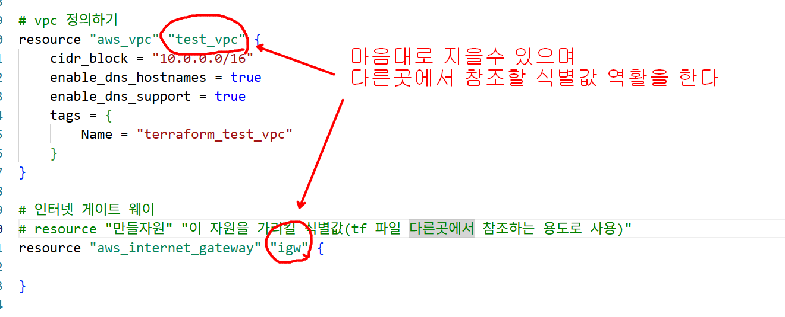
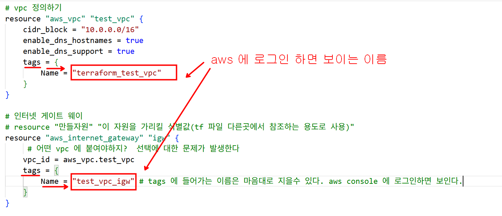

## Terraform 사용해 보기

### 명령어

```bash
# 초기화,  최초 1회 또는 프로바이더/모듈 변경 시 실행
terraform init
# 실행 계획 확인 
# 실제로 인프라를 생성하지 않고, 어떤 리소스가 생성(+), 변경(~), 삭제(-)될지 미리 시뮬레이션해 보여줍니다.
terraform plan

# 인프라 배포
terraform apply -auto-approve

# 인프라 삭제
terraform destroy -auto-approve

# 코드정리
terraform  fmt
```



