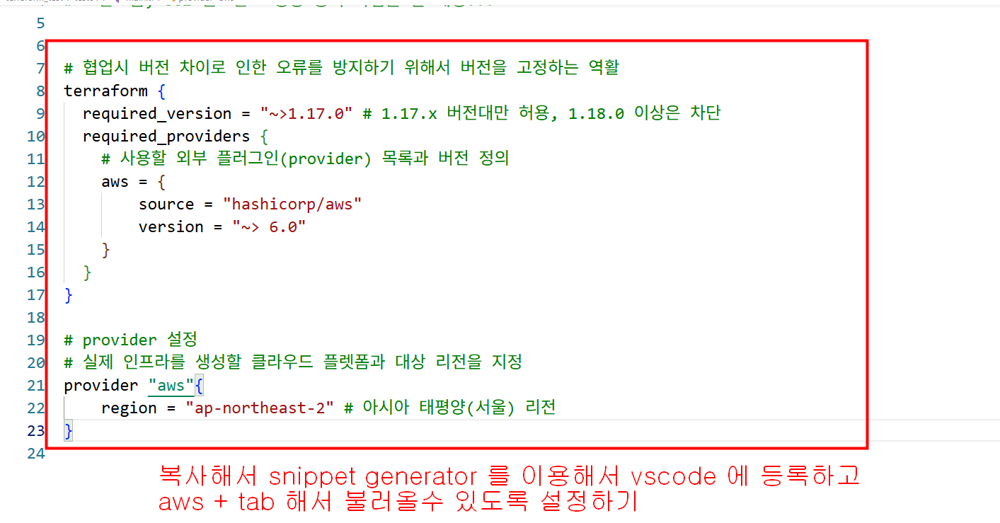
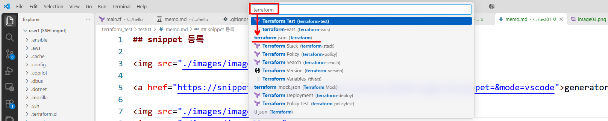
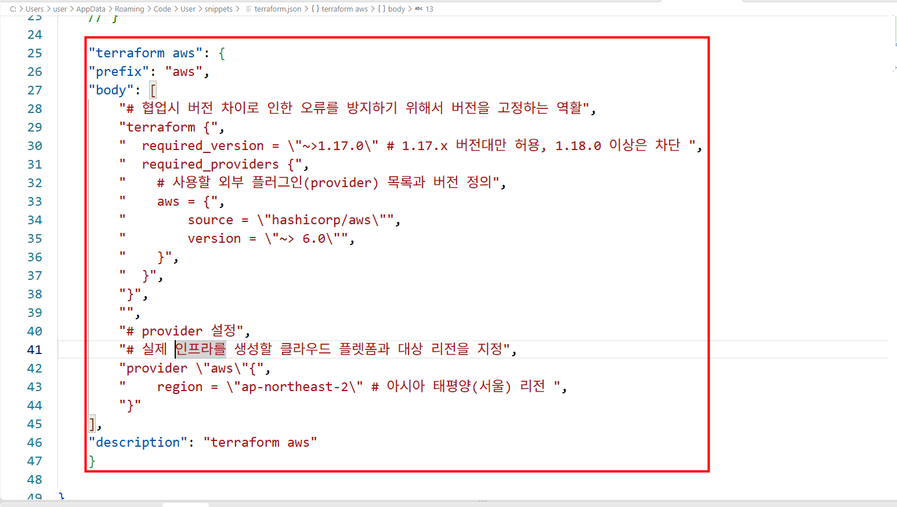
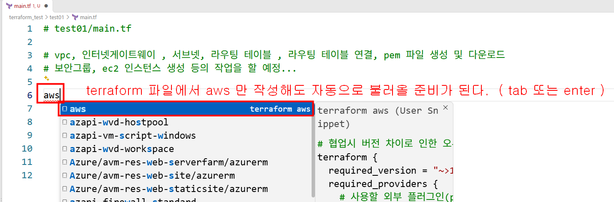
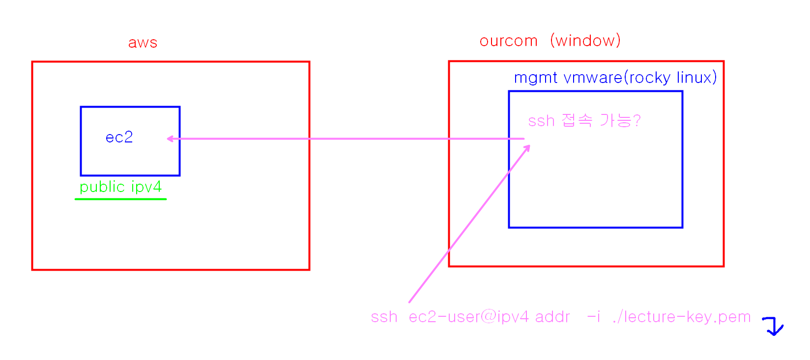
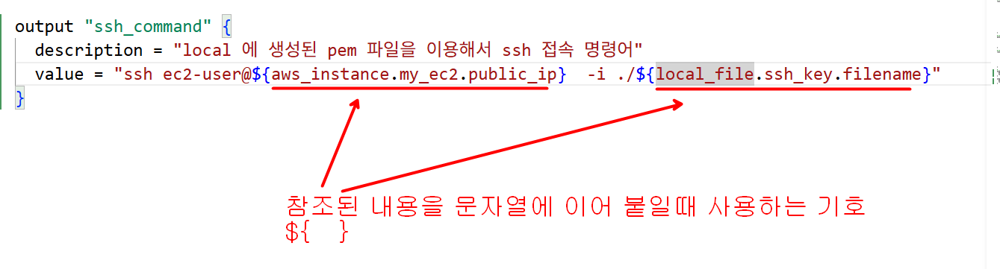

## snippet 등록



<a href="https://snippet-generator.app/?description=&tabtrigger=&snippet=&mode=vscode">generator</a>







## main.tf 를 apply 하고 만들어진 ec2 에 접속하는 방법



```bash
# local 에 존재하는 lecture-key.pem 파일을 이용해서 접속
ssh ec2-user@13.124.171.216 -i ./lecture-key.pem

# 접속후 실행하는 명령어는 aws 의 ec2 에서 실행되는 명령어 이다
ls -al

# 작업후에 다시 mgmt 로 빠져 나오는 방법
exit 

```

## terraform 파일에서 문자열 이어 붙이기

